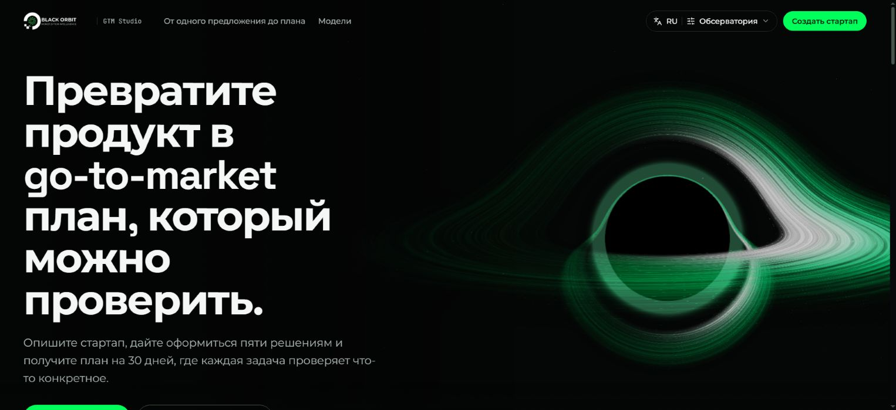
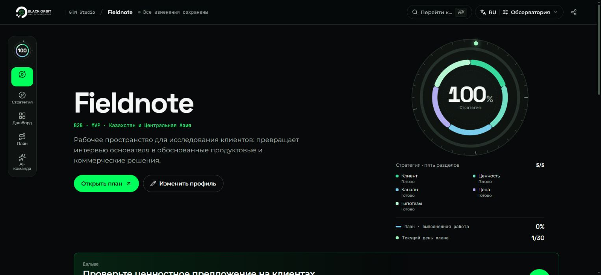
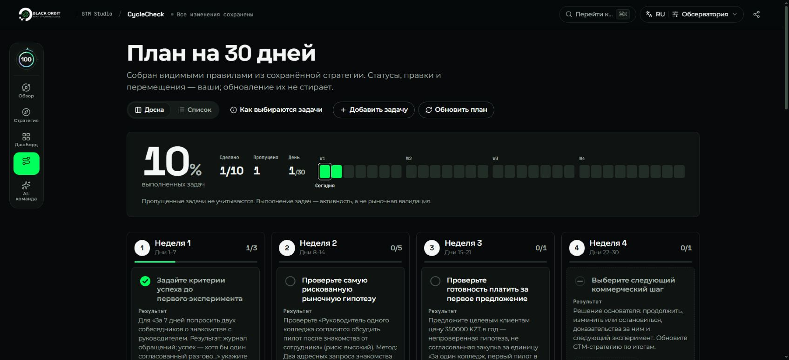
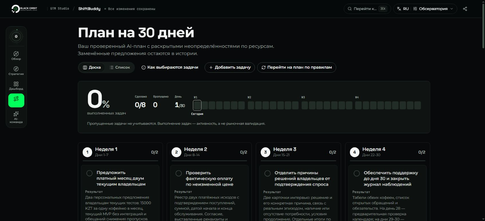

# Orbit GTM Studio

**From a startup idea to five commercial decisions and a practical 30-day go-to-market plan.**

[](https://github.com/Eye172/dev-test-assignment-1/actions/workflows/verify.yml)

[Live application](https://orbit-gtm-studio.vercel.app/) · [Explore Fieldnote](https://orbit-gtm-studio.vercel.app/startups/11111111-1111-4111-8111-111111111111) · [Demo walkthrough](docs/DEMO.md) · [Documentation](docs/README.md)



Built for the AI Startify developer assignment, Orbit brings startup context, strategy, visual models and execution into one persistent workspace. The original assignment workflow works without an AI subscription. Optional AI assistance interprets briefs, researches alternatives and proposes changes for the founder to review.

## Product journey

1. **Describe the startup.** Choose a guided brief or write freely, add materials and confirm the profile.
2. **Define five decisions.** Save the customer, value, channels, pricing and market assumptions independently.
3. **Inspect the strategy.** Find missing inputs, compare channels and choose a hypothesis to test.
4. **Build the next 30 days.** Generate a four-week plan, manage tasks and retain notes and completed work.
5. **Return to the same workspace.** A stable URL and server-side database preserve the startup and progress.



## Five strategy sections

| Section | Founder decisions |
| --- | --- |
| Ideal Customer Profile | Initial segment, buyer and situation triggering a need |
| Value Proposition | Customer problem, promised outcome and existing alternative |
| Acquisition Channels | Up to three channels, their rationale and first test |
| Pricing & Revenue | Revenue model, price hypothesis and willingness-to-pay test |
| Market Assumptions | Three assumptions, associated risk and validation method |

Each section has its own saved draft and completion state. **Completeness = completed sections ÷ 5 × 100%.** Empty drafts are allowed. Completed forms and tasks describe progress rather than proving market demand.

## Visual models

| Model | Purpose |
| --- | --- |
| Strategy orbit | Five colour-coded section states, plan progress and current day |
| GTM readiness | Six scored dimensions with the rules behind each score |
| Hypothesis map | Importance versus evidence, with numbered links to the list |
| Channel bullseye | Priorities, ICE scores and a suggested first test |
| Evidence ladder | Progress towards commitment, paid use and repeat use |
| Positioning | Customer, alternative, differentiated value and category |
| Bottom-up sizing | Account and price assumptions with their limitations |
| 30-day workload | Planned actions and available execution capacity |

Scores derived from saved fields are deterministic and inspectable. AI proposals and founder inputs retain their origin; unsupported claims remain hypotheses.

## A plan that retains your work

The rule-based planner produces **8–10 tasks** across four weeks. Tasks include a deliverable, rationale, week and status. Use a board or compact list, move tasks, add custom work and record notes. Regeneration reconciles suggestions with existing work and preserves completed, edited and custom tasks.



## AI-assisted decisions

The optional owner-gated studio uses the **OpenAI Agents SDK and Responses API**:

| Specialist | Contribution |
| --- | --- |
| Brief interpreter | Startup context, known facts and missing information |
| Researcher | Competitors, substitutes, pricing and captured source passages |
| GTM strategist | Initial customer, positioning and acquisition proposals |
| Monetization specialist | Pricing hypotheses, revenue logic and commitment tests |
| Experiment designer | Experiments, deliverables, dependencies and resource needs |
| Evidence critic | Unsupported claims, contradictions and review findings |

Clarifying questions use the actual brief. Research retains passages and coverage gaps. Proposals are compared with saved strategy and applied explicitly. Plan review checks weekly time, money and dependencies. Persistent messages, artifacts and usage accounting support later review.

Calls are explicit and metered. The default is `gpt-6.1-sol`, Standard service, low reasoning effort and bounded output/tool calls. Extra correction rounds are opt-in. See [AI architecture](docs/AI-BACKEND.md), [cost controls](docs/AI-COSTS.md) and [verification evidence](docs/STATUS.md).



## Three interfaces, three languages

| Interface | Experience |
| --- | --- |
| **Observatory** | Dark instrument panel, strategy orbit and autonomous WebGL black-hole scene |
| **Ledger** | Light editorial dossier, chapter navigation and compact models |
| **Flow** | System board connecting decisions, assumptions and execution |

All interfaces share the same data. Switch **English, Russian or Kazakh**, interface and theme from the header. Language changes preserve the founder's text. Responsive layouts, keyboard controls and reduced-motion support are included.

Share a display with `?ui=observatory&lang=ru`, `?ui=ledger&lang=en` or `?ui=flow&lang=kk`.

## Briefs and materials

Guided and free-form onboarding accept **PDF, DOCX, PPTX, TXT, Markdown and CSV**. Text is extracted on the device: three files, 5 MB per file and 20,000 extracted characters per file. PDF extraction covers up to 30 pages. Coverage, truncation and errors are shown before confirmation; extraction does not perform OCR.

The original brief and confirmed profile remain distinct. Optional AI interpretation reads supplied material. A local rules-only reader is available without a key. The founder confirms fields before creation.

## Run locally

Use **Node.js 24** and npm. Node.js 22.13+ is also supported.

```sh
npm ci
cp .env.example .env.local
npm run db:migrate
npm run db:seed
npm run dev
```

PowerShell: `Copy-Item .env.example .env.local`. Open [localhost:3000](http://127.0.0.1:3000).

Local development uses persistent **PGlite** in `.data/orbit`. Deployment uses **PostgreSQL** through `DATABASE_URL`; production requires a database. Do not share a PGlite directory between simultaneous processes.

### Configuration

| Variable | Purpose |
| --- | --- |
| `DATABASE_URL` | Server-only PostgreSQL connection; required on Vercel |
| `PGLITE_DATA_DIR` | Local database directory |
| `DEMO_MODE` | Synthetic, publicly editable demonstration data |
| `APP_ORIGIN` | Optional canonical origin for write checks |
| `TRUST_PROXY` | Enable only behind a host that overwrites forwarding headers |
| `OPENAI_API_KEY` | Optional server-only provider credential |
| `AI_ACCESS_CODE` | Owner gate for AI history and paid operations |
| `OPENAI_MODEL` / `OPENAI_CRITIC_MODEL` | Specialist model overrides |
| `AI_RUN_BUDGET_USD` / `AI_DAILY_BUDGET_USD` | Per-database estimated AI spending limits |
| `AI_AUTO_REPAIR` | Explicit opt-in to extra paid correction rounds |

Use the blank [environment template](.env.example). Keep real values in `.env.local` or hosting configuration, never in browser variables or Git. Public sample records are shared and editable; the AI owner gate is separate. Full settings: [technical guide](docs/DEVELOPMENT.md) and [deployment](docs/DEPLOYMENT.md).

## Engineering

**Next.js App Router · React · strict TypeScript · Zod · PostgreSQL/PGlite · Motion · OpenAI Agents SDK**

```text
src/app/           Pages and API routes
src/ui/            Interfaces, translations, visual models and landing
src/components/    Shared editors and workspace controls
src/lib/domain/    Validation, completeness, plan rules and insights
src/server/        Database, transactions, persistence and AI runtime
tests/             Domain, SQL and offline AI checks
e2e/               Browser acceptance and accessibility checks
docs/              Requirements, contracts, design and evidence
```

```sh
npm run verify       # lint, types, offline tests and production build
npm run test:e2e     # browser acceptance with an isolated database
```

CI uses PostgreSQL 17 and desktop/mobile Chromium. Paid evaluations are excluded from CI and require explicit opt-in. Browser evidence covers ten startup cases, both onboarding paths, materials, saves, plan lifecycle, locales and real provider responses. Exact revisions and results: [verification status](docs/STATUS.md).

## Documentation

[Assignment mapping](docs/ASSIGNMENT-CHECK.md) · [API/data contract](docs/CONTRACT.md) · [Design playbook](docs/design/CRAFT-PLAYBOOK.md) · [AI backend](docs/AI-BACKEND.md) · [Deployment](docs/DEPLOYMENT.md) · [Submission](docs/SUBMISSION.md) · [Changelog](CHANGELOG.md)

The implementation preserves the original six-screen assignment and rule-based workflow. The [documentation index](docs/README.md) separates current guides from historical handoff records. Asset provenance and font notices are retained in the design and license documents.
