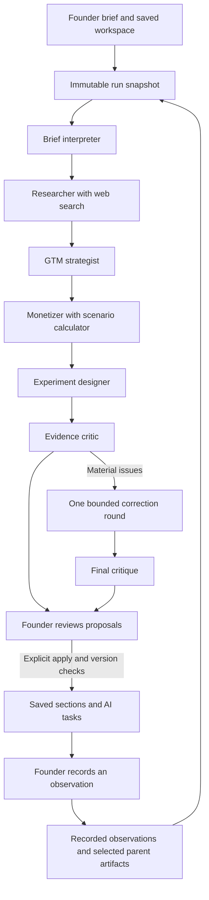
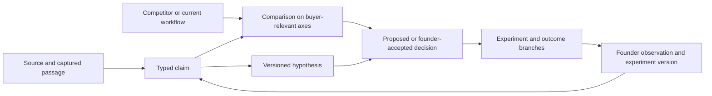

# Orbit agent architecture and quality review

Review date: 17 October 2026, UTC+5. Implementation baseline: `3cb60e547e691e451bb19135c03a56abfbfb07cb`, also the fetched `origin/main`. This review describes the shipped backend and proposes a bounded next iteration. Proposed contracts below are not implemented features.

The backend already executes six real specialists, retains their work in PostgreSQL, accounts for model calls, runs critique and requires explicit application. Its main weakness is the representation of commercial reasoning: competitors, hypotheses, observations and decisions are mostly connected through prose. Stronger prompts alone cannot make those relationships inspectable, consistently testable or suitable for useful widgets.

The next increment should strengthen research provenance, explicit evidence and decision relationships, and one feasible active plan. Six specialists are sufficient. Most of the improvement belongs in their contracts, context selection, verification and presentation.

## Assignment and delivery boundary

The original DOCX requires six screens, a persisted startup profile, five independently saved GTM sections, honest completion, and a transparent rule-generated 6–10-task roadmap. It prefers Next.js, React, TypeScript and PostgreSQL. AI-generated strategy was outside the original assignment; the owner subsequently authorized the real-agent expansion. Both requirements must coexist: the original demonstration journey must remain independently usable without a paid AI call.

| Requirement | Current implementation | Consequence for the next increment |
| --- | --- | --- |
| Six routes and stable profile URL | App Router pages and server-backed workspace | Keep all required routes accessible. |
| Five GTM sections | ICP, value, channels, pricing, assumptions; independent revisions and drafts | Free-form intake may assist these fields, but cannot remove required data. |
| Three assumptions and up to three channels | Domain schemas enforce these assignment constraints | Flexibility belongs in the content, supporting analysis and workflow. |
| Strategy completion | Completed required sections divided by five | Preserve this formula; show evidence separately. |
| Rule-based roadmap | Deterministic 8–10 current suggestions, retained history | Retain this path and its visible rules. |
| Persistence and safe edits | SQL transactions, revision checks, retained edits and task history | Extend these guarantees to new evidence and decision records. |
| Real AI requested by owner | Owner-gated API and six-role execution are merged | The published frontend has no Agents screen or controls calling this API yet. |
| Custom dashboard | Eight registered plates, saved order, allowed sizes, visibility and presets | Current plates read the legacy workspace, not AI research or evidence. |
| Submission | Source, live synthetic demo, README and handover exist | Final expanded submission still needs the approved interface and regenerated package. |

The `gpt/ai-integration-reference` branch contains a functional frontend reference. It is separate from main and is not the approved final design. Claude's independent design work is outside the changes made by this review.

## Current execution and communication

AI clients use `/api/startups/:id/ai`. The server authenticates the owner, freezes the workspace input, creates steps and schedules work with Next.js `after()`. `runAiJob` owns the sequence; each specialist is an OpenAI Agents SDK `Agent` using the Responses API.

This is a sequential workflow managed by application code. Agents do not autonomously message one another, choose arbitrary colleagues, or continue chatting in the background. The next model receives the newest completed artifacts assembled by the orchestrator. The database's `recipients` field describes journal routing; it is not a message broker that delivers model context.

Modes reduce the sequence: research uses intake, researcher and critic; pricing adds the monetizer; experiments uses intake, experimenter and critic. The strategy mode includes research, strategist and experimenter. A full run uses all six.

On material critique, the orchestrator selects up to two responsible roles, then includes specified downstream work. Research corrections can refresh strategy, pricing and experiments. There is one correction round and another critique. Remaining material concerns produce `needs_attention`. The system can also fail, pause or be cancelled; those states preserve completed artifacts.

### Prompts and role boundaries

The exact shared and role instructions live in [prompts.ts](../src/server/ai/prompts.ts); `effectiveInstructions` adds the operational length and research limits. Version 1.2 freezes and hashes the complete effective prompt and execution settings for each step.

| Role | Current prompt asks it to do | Tool | Output responsibility |
| --- | --- | --- | --- |
| Brief interpreter | Extract product, job, user, buyer, budget owner, stage, geography and constraints; detect contradictions; ask up to three useful questions | None | Brief interpretation, unknowns and questions |
| Researcher | Investigate direct competitors, indirect alternatives and manual or do-nothing workflows; compare buyer, job, offer, payment unit and distribution using relevant original sources | Hosted web search | Cited findings and implications; no saved strategy drafts |
| Strategist | Compare plausible initial positions, choose a first buyer, articulate value and a differentiation hypothesis, select channels and exactly three assumptions | None | ICP, value, channels and assumptions drafts |
| Monetizer | Compare suitable offers and revenue models; identify payer, price hypothesis, payment unit and commitment test | `calculate_scenario` | Pricing draft and explicitly conditional arithmetic |
| Experiment designer | Produce feasible tests across four weeks with hypotheses, methods, metrics, thresholds, effort and dependencies | None | Six to ten experiment proposals; operational prompt asks for six to eight |
| Evidence critic | Find unsupported assertions, contradictions, buyer/currency errors, bad arithmetic, workload problems and unfalsifiable tests; name responsible role and correction | None | Issues with severity and target; no strategy or experiment drafts |

Shared instructions distinguish `founder_statement`, `workspace_record`, `source_reported`, `inference` and `hypothesis`. They prohibit invented traction, sources and outcomes, preserve founder authority, and treat retrieved or founder text as untrusted task data. They request concise reasons and evidence rather than private chain-of-thought.

Defaults in code are `gpt-6.1-sol` for specialists and `gpt-6-astra` for critique. Intake and research use low reasoning effort; other roles use medium. Only the researcher can search, with two hosted search actions per call and low search context. No agent can apply its own output or access arbitrary application tools.

The existing Agents SDK architecture is appropriate for application-owned orchestration and state. The missing product relationships are application responsibilities. See official OpenAI documentation on [orchestration and handoffs](https://developers.openai.com/api/docs/guides/agents/orchestration).

### What messages actually contain

`ai_messages` records task metadata, tool results and structured artifacts. A task entry contains a snapshot hash, brief, prompt version and round. An artifact contains a role's typed result. Search entries retain actual actions, returned URLs, response identifiers and usage; calculator entries retain inputs and results.

The model input is assembled separately as `asOf`, assigned role and round, brief, full snapshot, source ledger and preceding artifacts. There is no founder-visible fabricated conversation between personas. A future activity view should show actual transitions such as Research completed, Critic raised an issue, and Experiments revised.

## Current memory and sources

| Information | What is stored and supplied now | Material limitation |
| --- | --- | --- |
| Business context | Immutable workspace snapshot per run | Full snapshots are repeated for roles instead of selecting only relevant context. |
| Previous work | Latest completed artifact per role from one explicitly selected parent run, plus its source ledger | Parent proposals have no explicit accepted, rejected or superseded decision status. |
| Founder observations | Kind, observation, interpretation, sample size, method, date, limitations and optional task/URL | No explicit link to a hypothesis or claim; `contradicts` has no typed target. |
| Task state when observed | Full task snapshot retained in SQL | `AiEvidence` serialization omits `task_snapshot`, so the model sees current workspace task state without this historical task payload. |
| Accepted applications | Before/after section or plan values in `ai_applications` | These application records are not included as a distinct decision history in `AiSnapshot`. Saved values are visible, but their reasoning is not. |
| External sources | URL, title, retrieval time and method from tool output | No durable supporting passage, page version, publication date or claim-to-passage link. |
| Prompt provenance | Effective instructions, settings, model, version and hash per step | The private export omits `input_snapshot`, expected vector and exact per-step assembled input. It is not a fully self-contained replay package. |

This is persistent application memory, not model training or a semantic retrieval system. PostgreSQL is sufficient for the current workspace size. A vector database would not by itself resolve the missing links or distinguish an accepted decision from an old proposal.

`checkCitations` confirms that an external URL came from the run's retrieved ledger and that an internal observation UUID exists in the snapshot. It removes unsupported references and downgrades unsupported external assertions. It does not establish that a page supports the sentence, that a vendor claim is true, or that an observation interpretation is correct. The critic receives these artifacts and source metadata but has no independent browsing tool or frozen supporting passages.

Keeping all returned URLs preserves provenance, but search returns can contain irrelevant pages. They should not all count as studied or decision-relevant sources. Follow-ups inherit the original retrieval dates; inheritance is not a fresh check.

## Concrete case and observed behavior

Dispatch Note is a synthetic evaluation startup: an MVP turning voice messages into structured dispatch notes for managers of Almaty courier teams with 5–20 drivers. The brief specified one technical founder, eight sales hours per week, a $300 experiment budget, no customers or payment evidence, and preservation of WhatsApp and Telegram workflows.

The complete six-role evaluation used prompt version 1.0. Its outputs are useful behavioral evidence, but do not establish that the newer 1.2 prompt has been tested in a new full six-role research run.

1. Intake separated drivers, manager-users and spending approvers. It noticed that sales capacity did not establish integration or support capacity.
2. Research compared WhatsApp transcripts, Telegram Premium and TLDL. It inferred that basic transcription was a weak differentiation hypothesis and suggested testing structured dispatch fields. Coverage was limited to messaging-adjacent alternatives.
3. Strategy narrowed the initial segment to managers doing repeated voice-to-record work and able to reach an approver. It drafted the four role-owned sections.
4. Monetization proposed an unvalidated KZT 15,000 pilot per team, one manager, ten business days and at most thirty messages. It compared a fixed pilot with later subscription or credit models. The calculator produced conditional revenue of KZT 45,000 for three paid teams; unknown costs stayed unknown.
5. Experiments produced eight tasks across four weeks. The critic caught inconsistent recruitment denominators, unresourced service beyond the planning window and ambiguity between follow-on commitment and money received. The correction changed the plan; the final critic reported no new material artifact errors.

This run estimated $0.878916 for 110,114 input and 26,044 output tokens. Its ledger contained 36 URLs, but research claims cited only four distinct URLs. Those counts measure retrieval and references, not deep reading of 36 pages.

There was a role-boundary failure in the older output: the researcher's recommendations also proposed this startup's pilot scope, price and execution plan. Current 1.2 instructions explicitly narrow ownership, but the general recommendation schema can still carry this content. Quality evaluation must check role leakage rather than relying on prompt prose.

In the later version 1.2 follow-up, the founder recorded a synthetic observation: only one of five screened managers transferred voice notes into a separate record, four worked directly in chat, and nobody committed to payment. This was a small convenience sample, not a market estimate.

The follow-up changed the immediate plan toward segment reachability and direct approver access before live value tests or payment requests. It retained the accepted thirty-message draft as the baseline and treated the earlier hundred-message proposal as history. A critic correction resolved stale inherited conclusions and the obsolete cap disagreement. Eight revised tasks fit a provisional eight-total-hour weekly ceiling and $250 in spending caps plus $50 contingency. This follow-up estimated $0.947622.

The right inference is that the selected workflow may be harder to find than assumed. It is not that 80% of the market rejects the idea, the price has failed, or no segment exists. Small-sample workflow observations cannot answer a willingness-to-pay question that was not properly tested.

### Research extension for this case

Public pages checked on 17 October 2026 add a missing category to the original comparison. This is a targeted extension, not a comprehensive Kazakhstan market study.

| Alternative | Source-supported description | Implication for Dispatch Note |
| --- | --- | --- |
| Existing chat and manual work | The synthetic brief establishes messenger use; the later founder observation reports four chat-only managers | The strongest baseline may be keeping the current process. Its actual time and error costs require observation. |
| WhatsApp transcripts | WhatsApp describes in-app, on-device voice transcription in its [official announcement](https://blog.whatsapp.com/introducing-voice-message-transcripts) | Transcription alone is an insufficient differentiation claim; test exact devices and languages. |
| Telegram Premium | The [official FAQ](https://telegram.org/faq_premium) describes voice-to-text for Premium accounts | An existing-account alternative needs comparison; local checkout and workflow fit remain unknown. |
| TLDL | Its [official page](https://tldl.app/en/) describes messenger-based summaries and to-dos, ten initial free summaries, prepaid credits and a EUR 6.99 monthly tier for one hundred summaries | It competes with interpretation as well as transcription. A structured-note idea must demonstrate value beyond a summary with actions. |
| Tookan | Its [official product description](https://help.jungleworks.com/knowledge-base/tookan-smart-delivery-management-platform/) describes dispatch, manager and driver apps, tracking, routing and proof of delivery. [Pricing](https://jungleworks.com/tookan/pricing/) distinguishes monthly from annual plans and task-based allowances | A dispatch platform is an adjacent substitute for the broader manager job. If the actual need is routing or operational control, a note tool may lose. Kazakhstan fit, purchase availability and onboarding burden are untested. |

The potential advantage is preserving an existing messaging workflow while returning useful, checkable dispatch fields. Its weaknesses are unproven prevalence of separate-record work, manual review burden, language and field accuracy, and the extra step of moving messages. No reviewed source demonstrates that Dispatch Note wins on these dimensions.

Pricing comparison must retain different units. EUR per summary, USD per delivery task/month and KZT per team/pilot cannot become a cheaper-than chart without an explicit workload, billing assumptions and a sourced exchange rate. Competitor prices also do not establish this startup's willingness to pay.

## Findings that affect the next version

| Priority | Finding and code evidence | Required change or acceptance criterion |
| --- | --- | --- |
| P1 | AI API has no merged consumer in `src/components` or startup pages | Complete and test the approved founder journey: brief, progress/recovery, research, proposals, critique, apply and observations. |
| P1 | Competitor comparison exists in prompt prose; `AiResult` has no competitor or comparison objects | Persist alternatives and comparison cells with explicit evidence and unknowns; render the same typed data. |
| P1 | Source validation checks ledger membership; critic cannot inspect supporting passages | Link each material external claim to an actual captured supporting passage or mark it unverified; allow a bounded verification request for decision-critical disputes. |
| P1 | `apply()` archives older untouched AI suggestions but retains rule-generated suggestions | Preview merge/replacement choices and produce one selected active plan within capacity while preserving history, edits, in-progress and completed work. Never silently discard rule tasks. |
| P2 | Observations have no hypothesis ID; accepted/rejected reasoning has no explicit record | Add versioned hypothesis and decision relationships and observation links. Keep observation separate from its interpretation. |
| P2 | Snapshot includes parent artifacts without proposal status or application history | Supply current accepted decisions separately from alternatives, rejected proposals and superseded conclusions. |
| P2 | `task_snapshot` is retained but excluded by `evidenceFromRow()` | Give reviewable observations their historical experiment version, rather than relying on the current task. |
| P2 | Experiment metrics, thresholds, effort and dependencies are mostly strings; application flattens them into notes | Retain typed experiment contracts, dependency IDs, numeric effort/cost assumptions and decision branches; keep free-form notes as notes. |
| P2 | Only the final critic's issues govern run completion and apply restrictions | Preserve an explicit issue register; unresolved specialist and deterministic-check issues must be resolved, deferred with a reason, or surfaced. |
| P1 | Pricing apply dependencies include intake, researcher, monetizer and critic, but omit strategist | Model actual artifact dependencies. A blocking error in buyer or value assumptions must prevent applying dependent pricing. |
| P2 | Three alternatives, two search actions and low context are universal operational limits | Select depth by the imminent decision and coverage gaps within explicit caps. Report shallow or incomplete coverage honestly. |
| P2 | Up to three questions per specialist can repeat | Select at most three unanswered questions for the founder across a run, with impact and provisional assumptions. |
| P2 | Export contains instructions and hashes, but not the full frozen input | Include the immutable snapshot and per-step input provenance in private exports. Preserve timestamps and source versions needed to audit a conclusion. |
| P2 | Main's editor initializes local state from props; the reference branch adds external revision handling | Ensure clean editors synchronize applied proposals and dirty/recovered editors retain drafts and show a comparison. |
| P2 | Current roadmap copy says rule-based, AI task provenance is not displayed, and `planDay()` counts only `generated` tasks | Make plan provenance and dates correct for accepted AI plans as part of frontend integration. |
| P2 | Live evaluation checks valid drafts, task count and nonempty sources | Add case-based checks for research relevance, evidence support, conditional decisions, capability constraints and adverse evidence. |

The current worker is checkpointed rather than a durable queue. It can pause between roles and requires Resume from a client or later owner action. Paid calls have no automatic retry; ambiguous provider outcomes retain reservations. This is an explicit MVP operating boundary, not evidence that work continues indefinitely after the browser closes.

Isolated offline SQL probes reproduced two findings with zero provider calls. A critic issue marked `blocking` against the strategist still allowed the monetizer's pricing to be applied; the same issue correctly blocked the experiment plan. In a separate synthetic workspace, applying six AI tasks left eight rule-generated tasks active, producing fourteen active tasks. The private export's keys also confirmed that it lacks the frozen input snapshot. These probes used an ephemeral in-memory database and no production data.

## Proposed bounded architecture

Keep the existing application, six specialists, database, owner gate and rule engine. Add one small relational evidence model and role-specific artifacts. Preserve the existing endpoint and result shape during migration; introduce a versioned optional analysis payload rather than breaking the frontend contract mid-redesign.

These are logical record types, not a requirement for seven new services. A few PostgreSQL tables with JSONB artifacts and validated links can serve them.

### Research contract

Start with the buyer's job, geography, workflow and purchase decision. Discover a bounded candidate set; select roughly three to five alternatives for deeper comparison when relevant. Include a current/manual baseline. Cover direct and indirect options when found, recording the search scope and gaps when not. Never invent a direct competitor to satisfy a quota.

Each selected alternative needs a stable identity, category, intended buyer/job, workflow, deployment or switching requirements, offer, relevant capabilities, pricing terms and source references. Each comparison cell must carry a value or explicit unknown, evidence references, and whether it is reported, observed or inferred. Absence from a vendor page means not found in the reviewed material, not proven absence of a feature.

Comparison axes must follow the case. For Dispatch Note: preserving driver behavior, structured fields, corrections, manager time, languages/devices, output destination, handling burden and billing unit. For another startup those axes can change. The quality contract stays fixed while the comparison content adapts.

For every conclusion, produce where the idea could win, where it loses, who should prefer an alternative, what remains unknown, and the next discriminating test. The researcher should actively seek reasons to reject the idea's supposed advantage.

Use discovery, selective page verification and comparison as phases of the existing researcher. The critic can request one focused evidence check within the correction and cost budget. A report should distinguish URLs returned by search, pages inspected, claims supported by passages, and findings refreshed in this run. When the budget ends, preserve findings and label the remaining coverage gap.

### Memory and decisions

Add stable hypothesis IDs and version history. Link observations to the hypothesis or experiment they bear on. Retain the original observation even when interpretation changes. An uncertain or contradictory result must remain visible alongside supporting observations.

A decision needs the question, alternatives, chosen option, evidence references, rationale, status, author and revision, plus the conditions that would reopen it. Useful statuses are proposed, accepted, rejected, deferred and superseded. Applying a draft is an implementation action; it should not silently imply that every recommendation in the artifact was accepted.

Build each role's context from current constraints, current accepted decisions, relevant observations, evidence passages, its upstream dependencies and unresolved issues. Include superseded material only when needed to explain a contradiction. Persist the selected context manifest. Summaries should point to original records so a reviewer can inspect them.

An evidence update creates a visible change proposal: which hypothesis is challenged, which decision may need review, and which downstream experiments are affected. It must not silently rewrite strategy or start paid calls.

### Experiments and one active plan

An experiment should retain hypothesis IDs, audience and qualification rule, method, metric and unit, sample/coverage requirements, deadline, success/failure/inconclusive branches, effort estimate, currency-specific cost assumptions and dependency IDs. Open text remains available for the method, rationale and unusual constraints.

The server can then check weekly effort totals, spending bounds, missing quantities, dependency cycles and inconsistent denominators without asking a model to judge arithmetic in prose. Unknown costs or capacity stay unknown. Costs in different currencies remain separate until an explicit conversion assumption is supplied.

Applying a new plan should first show overlap with current work. The founder chooses which pending suggestions to replace, merge or retain; manually edited, in-progress, completed and custom work needs explicit treatment. Keep superseded tasks in history. A refreshed rule plan remains available under its own provenance and must not silently reactivate a superseded competing plan.

A small experiment can produce a useful decision heuristic without statistical market validation. Require enough coverage to interpret the test and retain an inconclusive outcome when that coverage is missing. Do not set a commercial threshold after seeing the result.

### Prompt changes with enforceable outputs

The shared contract should require every recommendation to answer: which decision it serves, which claims support it, what contradicts it, what is assumed, why the alternative was not selected, what would change the recommendation, and the next test. Store these as references and typed fields, not a checklist buried in prose.

| Role | Focused addition to its instruction and output |
| --- | --- |
| Intake | Classify known constraints versus provisional assumptions; identify the next decision; deduplicate unanswered questions. Do not invent an operating model or make missing information block useful drafts unnecessarily. |
| Researcher | Return the alternative records, comparison cells, supporting passages, exclusions and coverage gaps. Challenge differentiation. Do not propose this startup's price or plan in general recommendation fields. |
| Strategist | Return a few plausible initial positions with explicit reasons for selecting one; reference comparisons and hypotheses. Identify a real loss against the strongest alternative. |
| Monetizer | Separate external list price, cost scenario and founder price hypothesis. Compare payment units and offer scope, then choose a test fitting the buyer and delivery capability. |
| Experimenter | Reference the exact hypothesis and decision; preserve denominators, numeric resource estimates and distinct pass/fail/inconclusive actions. Reconcile existing work before proposing new tasks. |
| Critic | Audit claim support against supplied passages, stale decisions, missing alternative categories and actual dependency links. Track issue resolution explicitly; agreement between models is not independent proof. |

The orchestrator enforces schema and reference integrity, cost and tool permissions, issue dependencies and apply checks. Founder approval determines strategic adoption. A model's valid JSON or an empty issue list establishes neither truth nor commercial success.

## Founder output and adaptable information displays

The result should lead with the next commercial decision and its basis, then allow inspection of the underlying work. A founder should receive a concise assessment, a relevant alternatives comparison, five editable section proposals, three priority assumptions, a feasible roadmap, unresolved questions and review concerns, plus source and decision history.

The existing JSON export remains useful as a backup. The richer private export should include the evidence relationships, research date/coverage, frozen input and prompt versions. A readable report can be derived from the same typed records; it must not require inventing a separate narrative truth.

| Display | Useful content and action | Current status |
| --- | --- | --- |
| Next decision | Question, recommended option, strongest counterargument, evidence, reopening condition; accept/edit/defer | Proposed richer model; current Next move is a deterministic gap/task selector |
| Alternatives comparison | Case-specific axes, our idea versus current work and products, unknown cells, evidence on inspection | Proposed; no current competitor object |
| Hypothesis and evidence | Statement, risk if wrong, supporting and contradicting observations, limitations, linked test | Proposed richer model; current Risk plate lists all saved assumptions as untested |
| Active experiment | Audience, method, metric, predefined threshold, resource estimate and conditional next action; record result | Task cards exist; structured AI experiment display is not integrated |
| Research coverage | What was searched, what was inspected, date, key unknowns and sources requiring refresh | Proposed; current source ledger only |
| Change review | Current versus proposed values, preserved work, conflicts and critic concerns; apply selected changes | API exists; approved frontend integration pending |
| Activity and history | Real specialist states, revisions, tool events and founder decisions | Events/messages exist; founder presentation pending |

The founder should be able to pin, reorder, resize, collapse or hide relevant analysis displays and retain a readable mobile order. Required assignment progress, gaps and next-action access must remain available. Current layout validation accepts exactly eight known plates; adding analysis widgets requires a compatible version/migration rather than inserting unknown IDs.

Use a small registry of reliable renderers fed by typed data. The model may recommend relevant display types, axes and default emphasis; the founder controls the arrangement. It should not generate executable UI code. Missing data should produce an honest unknown or a small evidence request, not fabricated graphs or empty decorative charts. Automatic recommendations must not rearrange the founder's saved layout.

Free-form briefs, custom context, editable proposals and user-defined comparison axes provide flexibility. Stable identifiers, provenance, required assignment fields, truthful labels and experiment quality provide the standard. A short novice summary and expandable analytical detail can use the same records.

## Verification and implementation order

Existing unit/SQL tests exercise persistence, revisions, idempotency, source membership, owner access, budgets, cancellation, checkpoint recovery and application history. HTTP/browser tests cover the public assignment journey and AI privacy/observation boundaries. The live script primarily checks that drafts validate, enough experiments exist and sources are nonempty. These checks are valuable infrastructure evidence, but do not establish research quality or commercial usefulness.

The full six-role paid case ran locally with real provider calls. The version 1.2 adverse-evidence follow-up and a real production experiments-mode run also completed. The production check exercised intake, experimenter, critic, revision, resume and idempotent application; it was not a fresh six-role production research evaluation. No new paid run was needed for this review.

Implement in three bounded slices:

1. Add typed alternatives, claims and passage references with research coverage. Improve the existing research/critic contract, retain compatibility, and evaluate relevance and support before increasing search depth.
2. Add hypothesis, decision and experiment-version links, focused context and a complete private audit export. Reconcile a single active plan and enforce resource/dependency checks. Preserve current domain rules and user work.
3. Integrate the approved frontend using the typed results, then verify the full founder cycle from brief to observation and revised decision. Regenerate the final handover and submission package from that integrated version.

Required adverse cases for the new quality evaluation:

- A returned URL does not support the cited sentence; the claim must remain unverified and cannot justify a dependent factual recommendation.
- A vendor annual price is mistaken for month-to-month, billing units differ, or local checkout is unknown.
- Direct competitors cannot be verified, a page is inaccessible, or no new search was performed; coverage must say so.
- New observations contradict a selected segment; do not infer population prevalence or price rejection from a small convenience sample.
- A rejected or superseded proposal conflicts with the founder's accepted decision; current decisions must remain authoritative unless explicitly reopened.
- A historical task changed after an observation; evaluate the version actually tested.
- Three qualified interviews cannot supply six qualified offers; missing test coverage stays inconclusive.
- Numeric weekly work or total spending exceeds capacity, costs are unknown, or dependencies cycle.
- A blocked buyer/value decision feeds pricing; dependent application must be blocked.
- A new AI plan overlaps a rule plan; preserve history and human work while presenting one intentional active plan.
- An applied proposal reaches a clean editor, a dirty editor and a recovered draft; no silent overwrite or stale autosave.
- B2C and B2G briefs require different buyers, channels and purchase cycles; avoid courier/B2B assumptions and generic startup advice.
- A user stops, closes the browser at a checkpoint, or reaches a budget limit; completed work and honest status remain available.

Assess these cases with explicit expected behaviors and inspectable evidence. Keep technical regression checks offline; use small, intentionally budgeted real-model evaluations for behavior that fixtures cannot prove. Do not use a second model's approval as the sole quality standard.

Primary implementation references: [domain contracts](../src/lib/domain/ai.ts), [prompts](../src/server/ai/prompts.ts), [runtime](../src/server/ai/runtime.ts), [AI persistence and apply](../src/server/ai/store.ts), [API](../src/app/api/startups/[id]/ai/route.ts), [AI tests](../tests/ai.test.ts), [live evaluation](../scripts/ai-eval.ts), [dashboard](../src/components/dashboard.tsx), [completion](../src/lib/domain/completion.ts), [roadmap rules](../src/lib/domain/roadmap.ts). The operational API boundary remains documented in [AI-BACKEND.md](AI-BACKEND.md).
