# Evidence, decision memory and AI execution

Owner-authorized expansion, 17 October 2026. The original assignment remains usable without paid AI: six required screens, five independently saved sections, exactly three market assumptions, up to three channels, saved-section completion, PostgreSQL persistence and a deterministic 30-day roadmap. `/startups/:id/agents` adds the private evidence workspace.

## Roles and communication

The official OpenAI Agents SDK calls the Responses API. Application code orchestrates six specialists in order:

```mermaid
flowchart LR
  B[Brief + immutable saved-state snapshot] --> I[Brief interpreter]
  I --> R[Researcher and comparator]
  R --> S[GTM strategist]
  S --> M[Monetization specialist]
  M --> E[Experiment designer]
  E --> C[Evidence critic]
  C -->|one bounded repair round| U[Affected roles and downstream work]
  U --> F[Final critique]
  C --> V[Founder review]
  F --> V
  V --> D[Accepted decisions and five saved strategy sections]
  D --> P[Preview and reconcile one active plan]
  P --> O[Real-world observations, including counter-evidence]
  O --> B
```

`src/server/ai/prompts.ts` contains the complete role instructions. Each step freezes its effective instructions and execution settings, hashes them together and saves the exact assembled input. Deployment cannot silently change an existing step's instructions. The private export includes both the original workspace snapshot and the actual role view.

The brief interpreter identifies the next commercial decision and constraints. The researcher compares substitutes for the buyer's whole job, including the present manual or do-nothing workflow. The strategist proposes the first buyer, value promise, channels, three hypotheses and a decision with alternatives. The monetizer compares payment units and offer models, keeps willingness to pay unproven, and uses deterministic scenario arithmetic. The experimenter proposes 6–8 tasks with falsifiable criteria, dependencies and resource estimates. The critic assesses source support, contradictions, arithmetic, workflow fit and feasibility.

Agents exchange typed persisted artifacts through the orchestrator. Recorded message kinds include task assignments, tool results and artifacts, with sender/recipients and IDs. This is an audit trail, not model chain-of-thought or simulated chat. Agents cannot write the startup, execute shell commands, read environment secrets or accept their own proposals. Targeted modes are research, strategy, pricing and experiments; `modeRoles` defines their graphs.

Default models are `gpt-6.1-sol` for specialists and `gpt-6-astra` for the critic. Tracing is disabled and Responses `store:false` is explicit. The snapshot, brief, observations and relevant preceding artifacts are sent to OpenAI. This is not a claim about zero retention under the provider account policy.

## Comparison and evidence

Version-2 artifacts use `src/lib/domain/analysis.ts`. Comparison axes are selected for the case, rather than supplied as a fixed feature checklist. Every alternative has a buyer, job, workflow, switching costs, relevance and pricing terms. Every alternative × axis cell is present, including explicit unknowns. Advantages and disadvantages of the idea each include a next test. Coverage records the search scope, exclusions, gaps and stopping reason.

Pricing separates description, amount, currency, payment unit, billing period and conditions. Annual prepayment and unknown taxes cannot silently become a monthly cash price. An unconfirmed currency removes the comparable numeric amount while preserving descriptive terms. Numeric competitor prices need compatible captured source findings; inference alone cannot ground reported competitor features or prices.

The researcher can use at most four hosted search actions and six `inspect_source` captures. Inspection accepts only URLs actually returned by this run's search or inherited ledger. DNS answers and redirects must be public, are validated and pinned for the HTTPS connection, and have network/size limits. Immutable captures retain time, SHA-256, status, limitations and passage IDs. Unavailable or truncated pages remain explicit. A returned search URL does not count as a read page.

Findings distinguish founder statements, saved workspace records, external source reports, inferences and hypotheses. External findings require actual captured passage IDs. Observations require actual IDs from the immutable snapshot. The critic must assess every current supplied external finding against its passages: supports, does not support or unclear. A relevant URL is insufficient. Vendor statements remain vendor-reported claims even after that support check; they do not prove customer outcomes.

Machine-detected contract defects are registered and cannot be waived by a model's prose. Corrected artifacts can resolve their earlier defects. Current dependencies determine which inherited findings support a proposal; retracted historical claims remain exported without forcing the critic to approve them. The source inspector displays a short passage excerpt and the original link.

## Memory and observations

Hypotheses and decisions have UUIDs, revision numbers, origin, status, rationale and immutable history. Statuses are proposed, active, accepted, rejected, deferred and superseded. Decisions retain compared options, selected option, strongest counterargument and reopening condition. Hypotheses retain risk and an explicit review trigger.

An AI proposal is not automatically accepted memory. The owner can accept a reviewed proposal or write/edit a record manually. Manual records work before any paid run. Existing memory revisions are checked at save/acceptance; an older AI proposal cannot overwrite a founder edit left in proposed status. The board distinguishes the saved judgment from a proposed replacement.

Observations store what happened, interpretation, method, sample size, local calendar date, source URL and limitations separately. They link explicitly to hypothesis IDs and optionally a task. The full task/experiment version is frozen when the observation is saved. Completed tasks and founder-reported payments are not independent proof of demand or transactions.

New observations flag linked hypotheses and dependent decisions for review, without changing their status or conclusion. A memory edit acknowledges only supplied reviewed evidence IDs plus previously reviewed observations. Evidence arriving after an editor opened stays unreviewed. Rejected, deferred and superseded memory remains historical context; current accepted/active decisions are separated from it in role inputs. Human-edited pending proposals are also identified separately.

## One active execution plan

Before applying a version-2 plan, the owner reviews a server-generated preview:

- Untouched pending rule/AI suggestions are proposed for retirement. Human-edited, custom, in-progress and completed work is retained by default. Completed work cannot be retired through AI plan acceptance.
- The founder can change scope, deliverable, method, week, effort, cash costs and decision deadline, recording a reason. The original proposal and reviewed selection remain in history.
- New and retained unfinished work share the same weekly capacity and currency-specific cash limits. Explicit unknown estimates stay unknown. Existing overlapping experiments must be reconciled.
- Dependencies must exist and precede their dependents; deadlines must fit assigned weeks. Workload and cash overruns block acceptance.
- Missing estimates or unconfirmed combined sales/delivery allocation require explicit acknowledgement. The resulting plan is labelled conditional, rather than capacity-verified.

A preview hash binds the reviewed selection to task, section and profile revisions. Changed data requires a new preview. Apply is transactional and idempotent. It supersedes the previous active plan, archives only selected suggestions and retains their history. Task notes and structured experiment criteria derive from the same accepted measurement.

Rule regeneration is blocked while an AI plan is active. An explicit switch with the expected plan ID restores the rule path and preserves human-owned work. Roadmap status formulas remain unchanged. Moving or editing a task retains its accepted experiment contract and makes the need to recheck criteria visible.

## API and access

All AI operations use `/api/startups/:id/ai`, same-origin JSON, the existing error envelope and no-store responses. `AI_ACCESS_CODE` unlocks a signed 24-hour HttpOnly, SameSite=Strict cookie, Secure in production. Unlock attempts are bounded. This is a single-owner studio gate, not tenant authentication.

| Operation | Contract |
| --- | --- |
| GET | Configuration/access flags; authorized state includes up to 30 recent runs, nextCursor, evidence, memory, findings and private analysis layout. `?before=UUID` pages older runs. Unauthorized state has empty private arrays. |
| GET `?sourcePageId=UUID` | Owner-only captured page, scoped to this startup. |
| GET `?export=1` | Full owner-only history: runs, messages, calls, applications, frozen prompts/settings/inputs/snapshots, findings, memory revisions and plans. |
| POST unlock / lock | `{action:"unlock",payload:{code}}` or `{action:"lock"}`. |
| POST create | `{action:"create",payload:{mode,brief,requestId,parentRunId?}}`. Same request UUID/content is idempotent. Work starts after the response. |
| POST resume / cancel | `{action,runId}`. Resume safe checkpoints; cancel fences late publication. Failed uncertain calls are never replayed automatically. |
| POST evidence | `{action:"evidence",payload:{requestId,taskId,kind,observation,interpretation,sampleSize,sourceUrl,method,observedOn,limitations,hypothesisIds}}`. Scoped IDs and idempotency are enforced. |
| POST memory | `{action:"memory",payload:{requestId,id,expectedRevision,status,data,reason,reviewedEvidenceIds}}`. `data` is a hypothesis/decision record. New client-generated IDs use revision 0. |
| POST remember | `{action:"remember",runId,stepId,kind,key}` explicitly accepts a reviewed artifact proposal. |
| POST layout | `{action:"layout",payload:{version:1,plates:[{id,hidden,collapsed,size}]}}`. Exactly six private analysis displays, once each; compact/wide sizes. |
| POST preview_plan | `{action:"preview_plan",runId,stepId,selection?}` returns selection, preview hash, totals, blockers, unknowns and readiness. |
| POST apply | `{action:"apply",runId,stepId,target,plan?}`. Version-2 roadmap acceptance requires `plan:{selection,previewHash}`. Other targets are the five section keys. |

All POST actions except unlock require owner access. IDs are scoped to the requested startup. Public demo profile/strategy/task/export routes still expose their synthetic shared content. Apply explicitly discloses that selected strategy/task content becomes shared. Private briefs, observations, findings and memory are excluded from public workspace exports.

Strategy application checks business profile, section/task revisions, evidence IDs and accepted memory versions. Display preferences do not invalidate business context. Changes accepted from the same run advance its expected revision vector, allowing several independent section saves. Clean mounted strategy editors synchronize new saved values; dirty/recovered editors keep their baseline and stop autosave on conflict.

## Limits, recovery and accounting

Runs may be queued, running, paused, completed, needs_attention, failed or cancelled. Completed means an internal review finished; it does not mean a business case is validated. Remaining blocking concerns prevent dependent acceptance.

Fenced leases prevent competing workers or late cancelled results from publishing. Each invocation pauses before the 300-second Vercel window. `after()` is not a durable queue: closing the browser at a checkpoint may require a later Resume. The client automatically resumes checkpoints for its newly started run and backs off polling when idle or hidden.

Limits include 18 model calls, 300,000 accumulated tokens before another call, one repair round, bounded searches/captures and no automatic provider retries. Intake timeout is 110 seconds; other roles have 200 seconds. Output allowance includes reasoning tokens. Settings and model rates live in prompts.ts/config.ts and are frozen per step.

Shared daily and per-run estimates are reserved transactionally before calls. Confirmed usage settles the reservation, including reported usage from incomplete Responses that the Agents SDK rejects. Uncertain interrupted calls retain their reservation and are never described as free. Application estimates are not provider invoices or account-wide spending guarantees. Defaults are $7/run and $15/day UTC; unknown model rates are rejected.

Local unfinished briefs, memory, observations, plan reviews and layout changes recover per browser tab. Recovery permits incomplete fields but server saves retain full validation. Pending commits lock editable review controls; old acknowledgements do not erase newer drafts.

## Verification and deployment

`npm run verify` runs offline domain/SQL tests, lint, types and the production build. Playwright covers the original public journey and the private comparison → memory → five sections → plan preview/application → adverse-observation loop at desktop and phone sizes. Offline synthetic artifacts are seeded only in the isolated test environment; there is no public fake-provider or seeding endpoint.

`npm run test:ai:live` is explicitly paid and excluded from CI. `AI_EVAL_PARENT_RUN_ID` optionally continues the same synthetic case using its captured research. `scripts/ai-eval-role.ts` is a separately labelled paid component diagnostic; it never claims end-to-end completion or applies proposals. `scripts/ai-smoke.ts` verifies owner-only HTTP application and can explicitly request a paid adverse-evidence follow-up. Private reports live under ignored `.data/ai-evals`.

Use one process per local PGlite directory, or isolated PostgreSQL. On Windows, Node may need `--use-system-ca` for the installed root CA; certificate verification remains enabled. Production uses Vercel Secrets and PostgreSQL. No real API key is required in CI.

Current release verification and real-call outcomes are recorded in ACCEPTANCE.md and SUBMISSION.md. Earlier version-1 successful runs are historical evidence, not proof that every version-2 path passed.

Official references: [Agents SDK](https://developers.openai.com/api/docs/guides/agents/quickstart), [structured outputs](https://developers.openai.com/api/docs/guides/structured-outputs), [web search](https://developers.openai.com/api/docs/guides/tools-web-search), [reasoning and output allowances](https://developers.openai.com/api/docs/guides/reasoning). Native source and tests are authoritative.
