# AI backend and frontend integration contract

Owner-authorized scope expansion, 17 October 2026. The original assignment's rule-based flow remains available. The owner additionally requested real OpenAI specialists, research, monetization, experiments and critique. Claude is independently revising the frontend; this document specifies the backend boundary without prescribing a visual layout.

## Runtime

The server uses the official OpenAI Agents SDK and Responses API. Six role-specific agents have versioned prompts in `src/server/ai/prompts.ts`, strict structured outputs in `src/lib/domain/ai.ts`, and application-owned orchestration in `src/server/ai/runtime.ts`.

```mermaid
flowchart LR
  Brief[Saved snapshot + founder brief + observations] --> Intake
  Intake --> Researcher
  Researcher --> Strategist
  Strategist --> Monetizer
  Monetizer --> Experimenter
  Experimenter --> Critic
  Critic -->|one bounded correction round| Specialists[Targeted specialists + affected downstream work]
  Specialists --> FinalReview[Final critique]
  Critic --> Review[Founder reviews proposals]
  FinalReview --> Review
  Review -->|explicit apply with version checks| Strategy[Five saved sections / AI experiment tasks]
  Strategy --> Observation[Founder records observed results]
  Observation --> Brief
```

The full run is sequential to limit paid concurrency and preserve a predictable context order. Targeted modes are `research`, `strategy`, `pricing` and `experiments`; `modeRoles` is the authoritative graph. Research uses hosted web search; monetization has a deterministic `calculate_scenario` function tool. No agent can mutate strategy, invoke arbitrary shell/network tools, read environment secrets or apply its own proposals.

Defaults: `gpt-6.1-sol` for specialists, `gpt-6-astra` for the critic. Agent traces are disabled and Responses `store:false` is explicit. Workspace snapshots, brief, observations and preceding artifacts are sent to OpenAI. This setting is not a claim of zero data retention under the provider's account policy.

## Endpoint

All requests use `/api/startups/:id/ai`. Same-origin checks, JSON size validation and existing request limits apply. Responses use `{data: ...}` or `{error:{code,message,fields?}}`, with `Cache-Control:no-store`.

| Method/action | Payload/result |
| --- | --- |
| GET | `AiStudioState`: configuration/access flags, up to 30 recent runs, `nextCursor`, recorded evidence and configured estimated budgets. `?before=<nextCursor>` loads older runs. Without owner access: flags/limits and empty arrays only. |
| POST `unlock` | `{action:"unlock",payload:{code}}`. Sets a signed 24-hour HttpOnly, SameSite=Strict cookie (Secure in production). Eight attempts per client per 15-minute bucket. |
| POST `lock` | `{action:"lock"}`. Clears cookie. |
| POST `create` | `{action:"create",payload:{mode,brief,requestId,parentRunId?}}`. `requestId` UUID is reused for retries of the exact same submission. Returns `{id,created}` immediately; job runs after the response. |
| POST `resume` | `{action:"resume",runId}`. Continue queued/paused work, or recover an expired worker. Safe checkpoints do not rerun completed steps. |
| POST `cancel` | `{action:"cancel",runId}`. Stops subsequent steps and prevents late artifact publication. In-flight provider work may still incur charges. |
| POST `apply` | `{action:"apply",runId,stepId,target}`. Target is `icp`, `value`, `channels`, `pricing`, `assumptions` or `roadmap`. Returns the updated legacy `Workspace`. |
| POST `evidence` | `{action:"evidence",payload:{requestId,taskId,kind,observation,interpretation,sampleSize,sourceUrl,method,observedOn,limitations}}`. Returns the saved observation. Same request ID/content is idempotent. |
| GET `?export=1` | Owner-only JSON download of runs, messages and before/after application history. Returns 401 without owner access. |

All POST actions except unlock require owner access. Every run, artifact, source, observation, application and AI export is behind that server gate. `AI_ACCESS_CODE` is a single-owner gate, not tenant authentication. The legacy public demo's workspace/profile/strategy/task/export routes still expose their synthetic shared data. Applying an AI proposal publishes that selected content into the shared workspace; disclose this before Apply. Private briefs and observations are excluded from legacy workspace/export responses.

Evidence kinds: `interview`, `commitment`, `payment`, `analytics`, `other`. Interpretations: `supports`, `contradicts`, `inconclusive`. `taskId` is nullable and must belong to the workspace; its full version is snapshotted. `sampleSize` is nullable or a positive integer. `observedOn` is an ISO date, URL is empty or HTTP(S). Observation/method/limitations remain separate. User-reported payment is not an independently verified transaction. No completion or validation percentage is changed by recording evidence.

## Run and artifact lifecycle

Run states: `queued`, `running`, `paused`, `completed`, `needs_attention`, `failed`, `cancelled`. `completed` means the internal review finished without unresolved material critic issues, not that business hypotheses were validated. `needs_attention` exposes remaining concerns. UI must show failed/cancelled/paused states honestly and retain readable completed artifacts.

Steps expose role, round, model, status, typed result, usage and estimated cost. Results contain summary, classified claims, recommendations/tradeoffs/next test, questions, nullable typed section proposals, experiments and review issues. Show only the newest revision by default; retain earlier revisions in history. A schema-valid response does not prove a claim. Validate all proposals against domain limits before checkpointing them as complete.

Sources come from actual hosted-tool output and citation annotations, with server retrieval time. Unsupported URLs are removed; unsupported `source_reported` claims are downgraded and flagged. Source presence alone does not verify that a claim is supported. Downstream agents and the critic receive the source ledger; parent-run sources travel with inherited artifacts. Founder-provided URLs stay founder observations, not verified research.

Application messages are persisted with IDs, sender, recipients, kind and structured content: task assignments, tool results and artifacts. They are not hidden model chain-of-thought. The journal is persisted from real state transitions, not simulated chat or progress percentages. From prompt/artifact version 1.2, the complete effective system prompt and execution settings are frozen per step, hashed together and included in the private export. A deployment that cannot replay that artifact/tool version rejects the step before paid work. Claim `evidenceIds` must reference supplied observation UUIDs; `workspace_record` claims describe saved snapshot state without requiring external URLs.

## Checkpoints, cost and recovery

Each invocation obtains a fenced lease. Work pauses before exhausting the 300-second Vercel function window; resume continues pending roles. `after()` is not a durable queue: if the browser closes at a pause, Resume is required later. A client may automatically resume checkpoints for the run it started. Poll active state approximately every 3 seconds; back off or stop polling in hidden tabs and after terminal states.

There are at most 18 model calls, 300,000 accumulated tokens before another call, two hosted search actions per researcher call, four SDK turns per specialist, and one targeted correction round. Calls have a 110-second timeout; no automatic provider retry. Explicitly rejected 400/401/403/404/422/429 calls release their reservation. Interrupted or otherwise ambiguous calls retain the reservation. A settled paid call without a durable artifact also stops for owner review; it is not silently rebilled on lease recovery.

USD estimates use configured model input/output rates, long-context multipliers and search-call fees. A transaction reserves the shared daily and per-run budget before each call, then settles against reported usage. Research reserves conservatively for hosted search's hidden context; normal calls reserve against serialized request bytes plus output allowance. These are application estimates, not provider billing receipts or account-level spending guarantees. Unknown model rates are rejected. Defaults: $7/run, $15/day UTC; owner may configure lower limits. A small limit can prevent a research call from starting because its reservation is intentionally conservative.

There is no fallback that labels rule-based or fabricated content as AI output. Sanitized errors distinguish credentials, permissions/model access, quota/rate limits, budget, provider timeout and invalid/incomplete output. Do not display raw SDK errors, secrets or sensitive request data.

## Applying and preserving work

Compare saved typed fields with the proposed fields, then request Apply explicitly. The server checks the immutable snapshot's profile data, all section revisions, task revisions and evidence IDs. Preference-only changes do not invalidate business context. Accepted changes from the same run advance a separate expected revision vector, allowing multiple section applications without accepting unrelated edits. JSON fingerprints are canonical across PostgreSQL JSONB key ordering.

Blocking critic issues propagate to dependent proposals. A blocked researcher/strategist/monetizer also blocks an experiment plan using that work. Re-run/follow up with a correction instead of hiding the issue. Applying superseded specialist revisions is rejected.

Apply is transactional and idempotent by run/step/target; before and after values are retained. Section notes survive. A mounted clean editor should synchronize a newer server revision; a dirty/recovered editor must keep its original baseline, stop autosave on conflict, and provide comparison/reload/copy choices.

AI roadmap tasks use `source:"ai"` and stable `ai:<artifactUUID>:<index>` provenance. Rule-generated tasks retain `source:"generated"`; custom tasks retain `source:"custom"`. Applying a plan adds 6–10 typed experiments and retires only untouched older AI todo suggestions. Completed, edited, in-progress and custom work remains. Rule regeneration cannot archive AI tasks. Task notes carry hypothesis, method, metric, threshold, effort and dependencies. Existing progress formulas remain unchanged.

## Configuration and verification

Use `.env.example`. Keep `OPENAI_API_KEY`, model settings, `AI_ACCESS_CODE` and budgets server-only. Never use `NEXT_PUBLIC_` or put a key/code into a shared URL. Production key and owner code are stored as Vercel Secrets; API models default in server configuration.

`npm run verify` runs offline tests and the build. CI never needs a real API key. `npm run test:ai:live` is an explicitly paid synthetic evaluation; it creates a workspace and saves its private report under ignored `.data/ai-evals`. It is not part of CI. Use a separate local PGlite directory and only one process per directory, or isolated PostgreSQL.

Live evaluation on 17 October: all six roles completed, a critic-triggered experiment revision and final critique completed, five domain-valid section proposals, eight experiments, 36 retrieved URLs. Reported usage: 110,114 input + 26,044 output tokens, estimated $0.878916. No customer validation was claimed. Two earlier research timeout attempts were preserved as failed runs with conservative reservations; they are excluded from this successful run's estimate and must not be described as free.

Official references: [Agents SDK](https://developers.openai.com/api/docs/guides/agents/quickstart), [structured outputs](https://developers.openai.com/api/docs/guides/structured-outputs), [web search](https://developers.openai.com/api/docs/guides/tools-web-search), [Vercel duration](https://vercel.com/docs/functions/configuring-functions/duration). Native source files and tests are the authoritative implementation.
